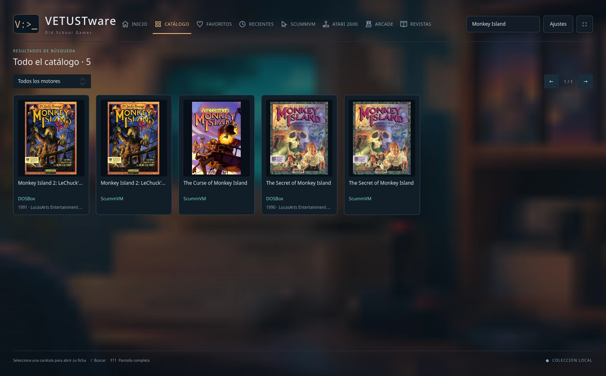
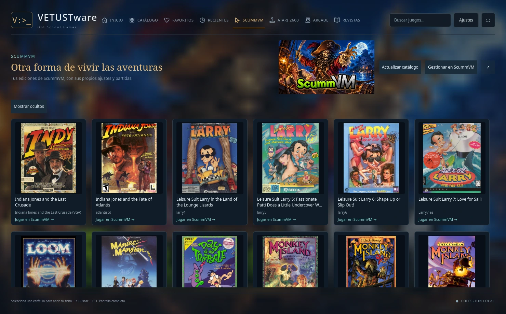
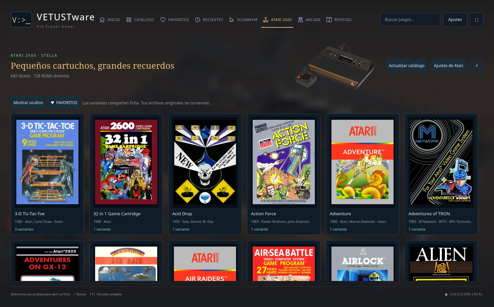
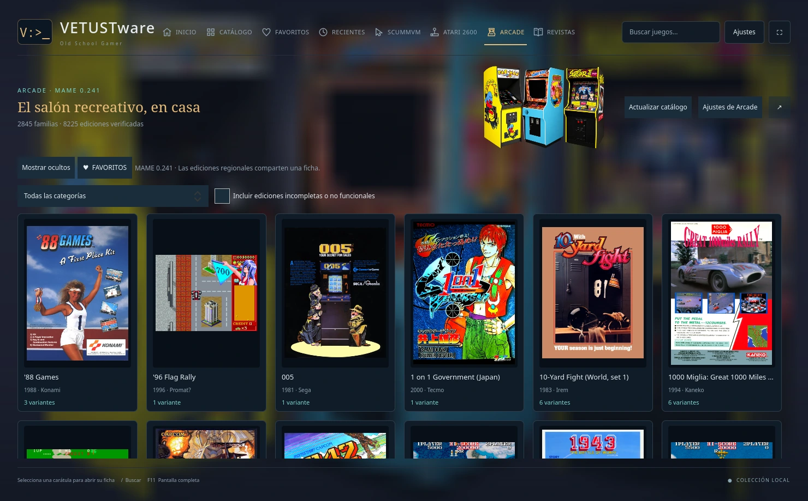

# VETUSTware · Old School Gamer

[English](README.md) · **Español**

VETUSTware es una aplicación nativa para Linux que reúne tus juegos de **DOS, ScummVM, Atari 2600 y arcade**. Puedes buscar un título entre los cuatro sistemas, elegir la edición y jugar desde su ficha. En Revistas puedes volver a leer las publicaciones de la época, con el mismo visor que usas para los manuales.


**¿Qué versión instalo?** Las capturas muestran la rama actual `main`. Para usar el catálogo de cuatro motores, compila esa rama. La última descarga, **0.3.4 para Linux x86_64**, es una versión preliminar con la biblioteca DOS, las revistas y el visor PDF, con interfaz en inglés y español. [Descargar 0.3.4](https://github.com/dejotaerre/vetustware/releases/tag/v0.3.4) · [Instalar el paquete](https://github.com/dejotaerre/vetustware/blob/v0.3.4/INSTALACION.md) · [Compilar desde el código fuente](#compilar-desde-el-código-fuente)

## Una búsqueda para cuatro bibliotecas

Si buscas **Monkey Island** en Catálogo, verás juntas las ediciones de DOSBox y ScummVM. Cada carátula indica el motor con el que se abre el juego. Puedes filtrar por motor o entrar en su sección para explorar las variantes y sus ajustes. En Inicio, el destacado de DOS va alternando entre juegos afines a tus gustos y descubrimientos del resto de la colección.



| Biblioteca | Qué puedes hacer |
| --- | --- |
| **DOS · DOSBox** | Elegir una edición o traducción de tu biblioteca, abrir su manual y sus extras, o entrar en una consola DOS con las unidades y el CD del juego ya montados. Puedes elegir Staging, DOSBox clásico o DOSBox-X y ajustar el sonido, el vídeo o la CPU para un juego concreto. |
| **ScummVM** | Explorar aventuras ordenadas por saga, elegir una edición detectada, ocultar juegos o abrir el gestor de ScummVM. Cada edición tiene sus propios ajustes de ejecución y partidas. |
| **Atari 2600 · Stella** | Reconocer un cartucho por la caja, ver una captura del juego y elegir la variante que quieres jugar. Puedes marcar favoritos y ocultar títulos. |
| **Arcade · MAME 0.241** | Explorar las máquinas por familia, elegir una edición regional y filtrar por categoría o estado de funcionamiento. Antes de jugar se comprueba el conjunto de ROMs elegido con MAME 0.241. |

<details>
<summary>Ver la ficha de un juego y las secciones de ScummVM, Atari y Arcade</summary>

**DOS.** La ficha de Larry 7 muestra la edición en español junto con la caja, las capturas, el manual y los extras de la biblioteca.


**ScummVM**



**Atari 2600**



**Arcade**



</details>

## Revistas y manuales

Explora las revistas por colección y número. Puedes abrir un PDF en el visor interno o arrancar una revista en disco mediante DOSBox. Los documentos verticales de varias páginas se abren en doble página, con la portada sola. Los cursores izquierdo y derecho pasan las páginas. También puedes ajustar el tamaño al ancho de la ventana o leer una sola página.


<details>
<summary>Ver las colecciones de revistas, la lectura a una página y los ajustes de fondo</summary>


En **Ajustes → Fondos de las secciones** puedes elegir una imagen para cada sección. En Ajustes la ves nítida y completa. Al volver a la biblioteca aparece difuminada detrás de las carátulas.


</details>

## Usar tu colección

VETUSTware se instala por defecto en `~/vetustware`. En **Ajustes → Bibliotecas y almacenamiento** puedes elegir las colecciones que tengas, incluso si están en discos distintos. Cada colección organizada lleva sus carátulas, catálogos y manuales en su propia carpeta `metadata/`. Los ajustes personales y las partidas se guardan por defecto con la aplicación. También puedes elegir otra carpeta para las copias jugables de DOS. Los juegos, ROMs, imágenes de disco y publicaciones de las capturas proceden de una biblioteca local y se aportan por separado. [Organización de las bibliotecas](docs/BIBLIOTECAS.md)

Para ScummVM y Stella, la versión en desarrollo da prioridad a los motores instalados en `~/vetustware/runtime` y permite buscar actualizaciones compatibles de forma manual. Arcade usa MAME 0.241 con un conjunto de ROMs de esa versión. [Instalación y actualización de motores](docs/RUNTIMES.md) · [Biblioteca y partidas de Arcade](docs/ARCADE.md)

## Compilar desde el código fuente

Para compilar la rama `main` necesitas un compilador C++20, CMake 3.21 o posterior, pkg-config, Qt 6.5 o posterior (Quick, Quick Controls, QML Dialogs, Quick Effects, SQL con SQLite, Concurrent, PDF Quick y Test), libzip, SDL2 y Python 3. Ejecuta estos comandos desde la raíz del repositorio.

```sh
cmake -S native -B native/build -DCMAKE_BUILD_TYPE=Release
cmake --build native/build -j 4
ctest --test-dir native/build --output-on-failure
python3 helpers/install.py --desktop
```

Abre VETUSTware desde el menú de aplicaciones y elige tus bibliotecas. El ejecutable preliminar 0.3.4 se compiló en CachyOS con Qt 6.12 y necesita bibliotecas de sistema compatibles. Si instalas ese paquete, utiliza el formato de biblioteca documentado para esa versión. [Guía de instalación de 0.3.4](https://github.com/dejotaerre/vetustware/blob/v0.3.4/INSTALACION.md)

## Idiomas y colaboradores

La interfaz actual abre en **inglés** y también está disponible en **español** y **portugués de Brasil**. Puedes cambiarla en **Ajustes → Idioma de la interfaz**. Los juegos y las publicaciones conservan su propio idioma. Para aportar una traducción basta con añadir un diccionario JSON y ejecutar el validador. [Guía de traducción](docs/TRANSLATING.md) · [Cómo colaborar](CONTRIBUTING.es.md) · [Informar de un problema](https://github.com/dejotaerre/vetustware/issues)

Dejotaerre creó y mantiene VETUSTware, con asistencia de OpenAI Codex en implementación, pruebas y documentación. El código propio se distribuye bajo la licencia MIT. Las dependencias, las imágenes de los juegos y las publicaciones conservan sus respectivas licencias. [Licencia](LICENSE) · [Avisos de terceros](THIRD_PARTY.es.md)
