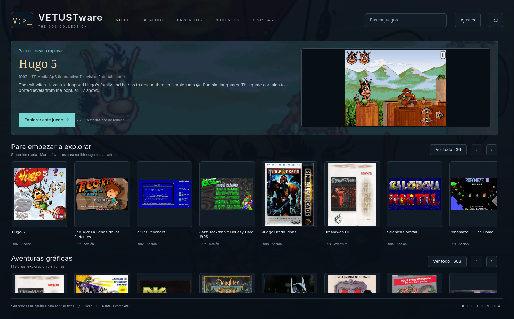
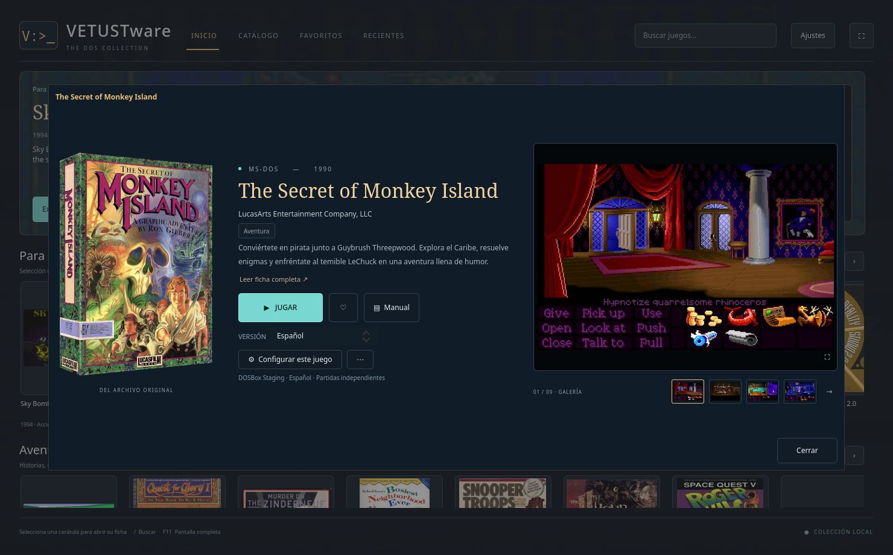
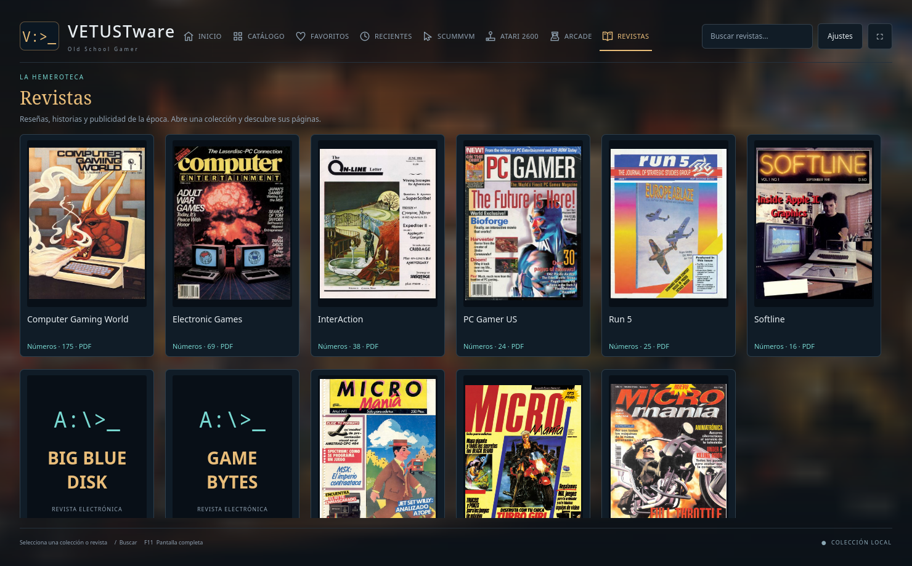
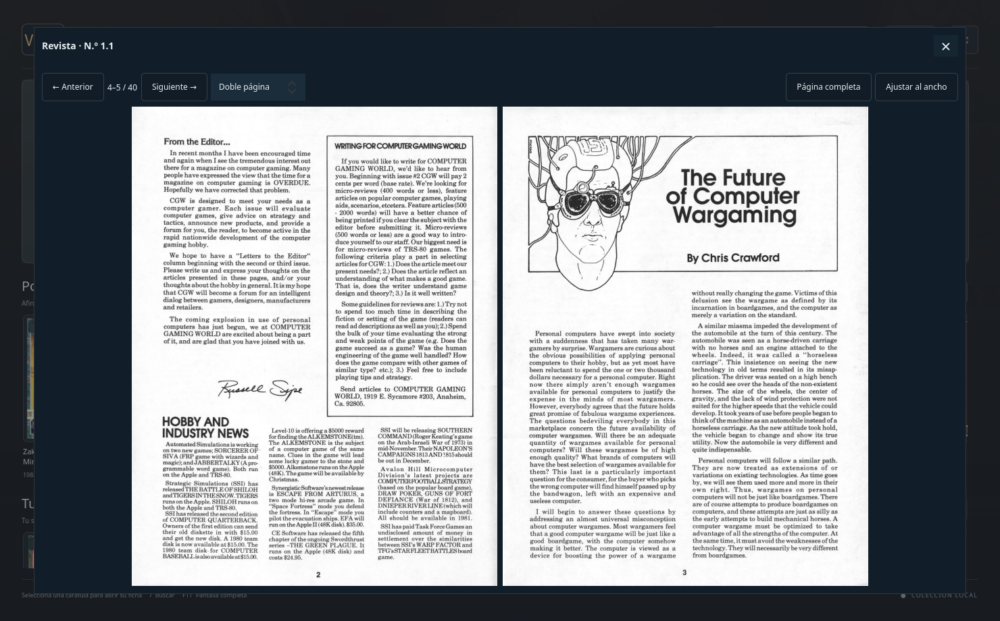
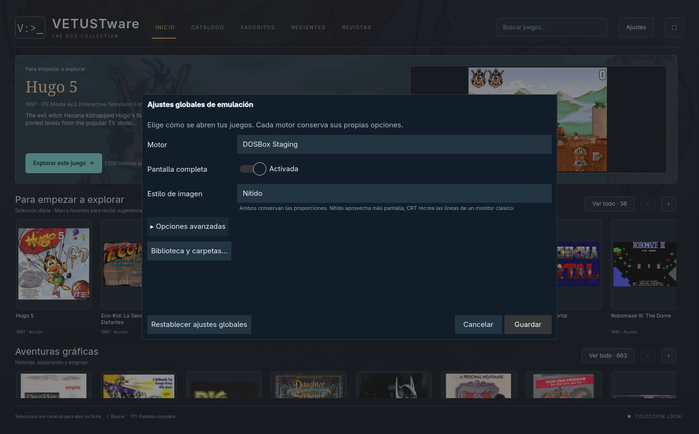
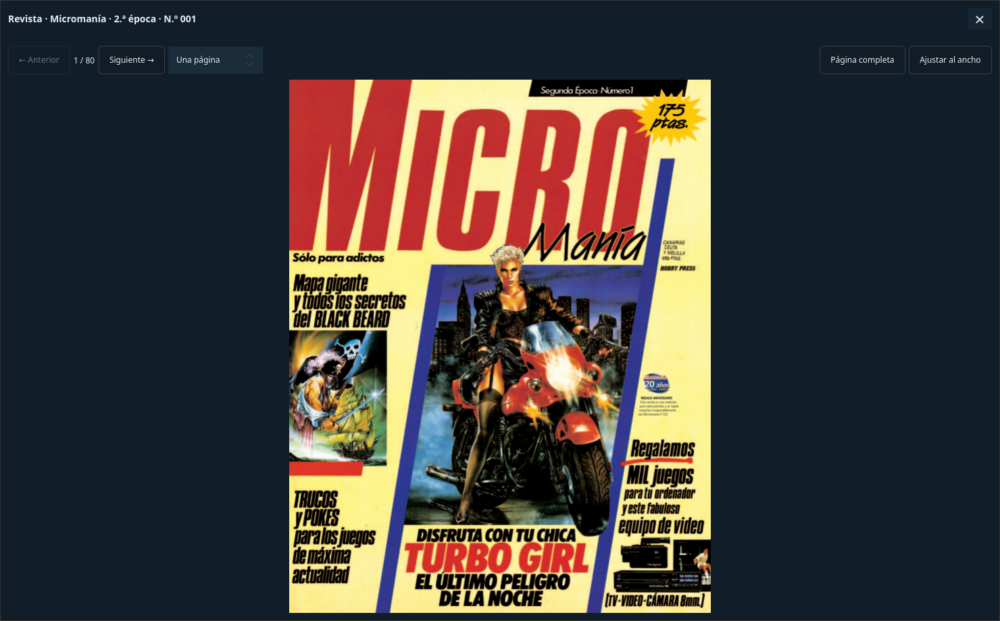

# VETUSTware

[English](README.md) · **Español**

**Tu colección DOS, lista para explorar y jugar.**

VETUSTware es una aplicación nativa para Linux, escrita en C++20 y Qt Quick,
que organiza una biblioteca local de juegos MS-DOS y los abre con DOSBox.
Carátulas, fichas, manuales y configuraciones individuales en una interfaz
pensada para disfrutar de la colección. No necesita un navegador ni una cuenta.



[Descargar 0.3.4](https://github.com/dejotaerre/vetustware/releases/tag/v0.3.4)
· [Instalación](INSTALACION.md)
· [Bibliotecas](docs/BIBLIOTECAS.md)
· [Reportar un problema](https://github.com/dejotaerre/vetustware/issues)

## Qué puedes hacer

- Explorar categorías y selecciones, buscar juegos, guardar favoritos y volver a los recientes.
- Consultar carátulas, capturas y manuales desde la ficha de cada juego.
- Elegir DOSBox Staging, DOSBox clásico o DOSBox-X, con ajustes globales y por juego.
- Cambiar pantalla completa y elegir monitor cuando hay más de uno disponible.
- Elegir imagen Nítida (predeterminada) o Monitor clásico (CRT) en DOSBox Staging,
  globalmente o por juego, conservando las proporciones.
- Acceder a opciones avanzadas de CPU, memoria, vídeo, sonido y ejecutable del emulador.
- Abrir una consola DOS con las unidades y las imágenes del juego montadas.
- Usar XTree Gold o Norton Commander cuando la biblioteca aporte esas herramientas.
- Reconocer ediciones y perfiles personalizados de una biblioteca VETUSTware.

Desde 0.3.1, el botón **Extras** permite consultar los documentos y medios
complementarios que aporte la biblioteca. Los PDF se muestran dentro de la
aplicación; otros formatos usan el visor del sistema. Consulta
[el formato de complementos](docs/BIBLIOTECAS.md#complementos-opcionales-desde-031).

Desde 0.3.2, **Revistas** permite explorar colecciones con portadas, lectura
PDF integrada y revistas electrónicas mediante DOSBox. El material se aporta
en `Revistas/` dentro de la biblioteca; no se incluye en el motor. Consulta [su formato](docs/BIBLIOTECAS.md#revistas-opcionales).

Capturas en español: las originales de **0.3.2** y la nueva vista de doble página de **0.3.4**.

**Ficha del juego:** selección de edición, manual, extras y configuración individual.



**Revistas:** colecciones de publicaciones en PDF y revistas electrónicas para DOS.



**Visor PDF en doble página (0.3.4):** portada sola y después los pares 2–3,
4–5, etc. Los cursores izquierdo/derecho cambian de par; Página completa y Ajustar
al ancho actúan sobre ambas páginas. El ejemplo muestra Computer Gaming World,
publicada en inglés, con los controles del visor en español.



<details>
<summary>Ver los ajustes y el visor PDF</summary>

**Ajustes:** pantalla completa con un interruptor, imagen Nítida por defecto y
opciones avanzadas plegadas. El selector de monitor aparece cuando se detecta
más de uno; esta captura corresponde a una sola pantalla.



**Lectura de una página:** la vista original sigue disponible. Esta captura anterior
muestra el manual de Larry 7 en español. X o Escape cierran el visor.



</details>

Las capturas ilustran una biblioteca aportada localmente. Los juegos, imágenes,
manuales y revistas que aparecen no se incluyen en el programa ni en sus descargas.

## Empezar

La versión **0.3.4 es una versión de prueba para Linux x86_64**.
El ejecutable publicado se compiló y probó en **CachyOS con Qt 6.12**. No es un
paquete universal: necesita bibliotecas compatibles del sistema. El código
fuente permite compilar en otras distribuciones; su compatibilidad todavía
requiere pruebas.

1. Instala las dependencias indicadas en [INSTALACION.md](INSTALACION.md) y un
   emulador DOSBox. Los perfiles se han trabajado principalmente con DOSBox Staging.
2. Descarga y extrae `vetustware-0.3.4-linux-x86_64.tar.gz` desde
   [Releases](https://github.com/dejotaerre/vetustware/releases).
3. Dentro de la carpeta extraída, ejecuta:

   ```sh
   python3 helpers/install.py --desktop
   ```

4. Abre VETUSTware y elige tu biblioteca local compatible.

El destino predeterminado es `~/vetustware`. La biblioteca puede estar en otro
disco. Las copias jugables se crean al necesitarlas en `data/games` dentro de
la instalación, o en la carpeta alternativa elegida por el usuario.

El motor **no incluye ni descarga juegos, ISOs, ROMs, carátulas, manuales,
emuladores ni herramientas DOS de terceros**. También funciona con una
biblioteca personalizada ya preparada, siempre que se aporte por separado.

## Motor, biblioteca y partidas

| Parte | Contenido | Ubicación |
|---|---|---|
| Motor | Aplicación, helpers, ajustes y datos locales | `~/vetustware` por defecto |
| Biblioteca | Archivos originales, metadatos y personalizaciones opcionales | Cualquier carpeta o disco disponible |
| Copias jugables | Archivos extraídos y partidas de cada usuario | `data/games` o destino personalizado |

La biblioteca se consulta en lectura. Las partidas y cambios de cada jugador
se guardan en sus copias jugables. Recuperar una copia desde la biblioteca no
recupera partidas posteriores que se hayan borrado.

La versión actual admite la estructura eXoDOS descrita en la guía y las
bibliotecas personalizadas VETUSTware. No es un importador general de carpetas
arbitrarias de juegos o ISOs. Consulta [el formato de biblioteca](docs/BIBLIOTECAS.md).

## Compilar y probar

Se necesitan C++20, CMake 3.21 o posterior, pkg-config, Qt 6.5 o posterior
(Quick, QuickControls2, Sql/SQLite, Concurrent, PdfQuick y Test), libzip y SDL2.
Python 3 se utiliza para instalar e importar metadatos.

```sh
cmake -S native -B native/build -DCMAKE_BUILD_TYPE=Release
cmake --build native/build -j 4
ctest --test-dir native/build --output-on-failure
python3 helpers/install.py --desktop
```

Las pruebas utilizan datos sintéticos y no necesitan una colección de juegos.
Incluyen extracción ZIP, catálogo, emulación y navegación de la interfaz.

## Estado y límites

- La versión 0.3.3 incorpora inglés predeterminado y español seleccionable; los nombres y descripciones importados dependen de la biblioteca.
- Cada juego puede requerir un motor DOSBox o ajustes específicos. Importar un perfil no verifica su compatibilidad.
- Escritorio Linux con X11 o XWayland; otras plataformas y Wayland nativo no están validados en esta versión.
- El selector de monitor depende de las capacidades del emulador y del entorno gráfico.
- No hay descargas automáticas de bibliotecas, traducciones ni imágenes.

Para colaborar o informar de errores, consulta [CONTRIBUTING.md](CONTRIBUTING.md).

## Licencia

El código propio de VETUSTware se publica con licencia [MIT](LICENSE).
Las dependencias y los contenidos de terceros conservan sus propias licencias.
Las imágenes de juegos visibles en las capturas no están cubiertas por la
licencia MIT del código. Más información en [THIRD_PARTY.md](THIRD_PARTY.md).

## Idiomas de la interfaz

Desde la versión 0.3.3, la interfaz inicia en inglés; puedes seleccionar español
desde **Settings → Interface language → Español**. La elección se aplica al
instante y se guarda sin cambiar el idioma de los juegos ni las versiones especiales.
Esta mejora está incluida en la descarga 0.3.3.

Cualquier colaborador puede añadir otro idioma mediante un archivo JSON, sin
recompilar la aplicación. Consulta la [guía de traducción en inglés](docs/TRANSLATING.md).
Se conservan las capturas originales en español de la versión 0.3.2 y se añade
la vista de doble página de 0.3.4. El [README en inglés](README.md) también incluye
la nueva captura con sus controles en inglés.

## Colaboradores

- **Dejotaerre** — creador y responsable del proyecto.
- **OpenAI Codex** — asistencia de IA en implementación, pruebas y documentación, bajo la dirección del responsable del proyecto.
