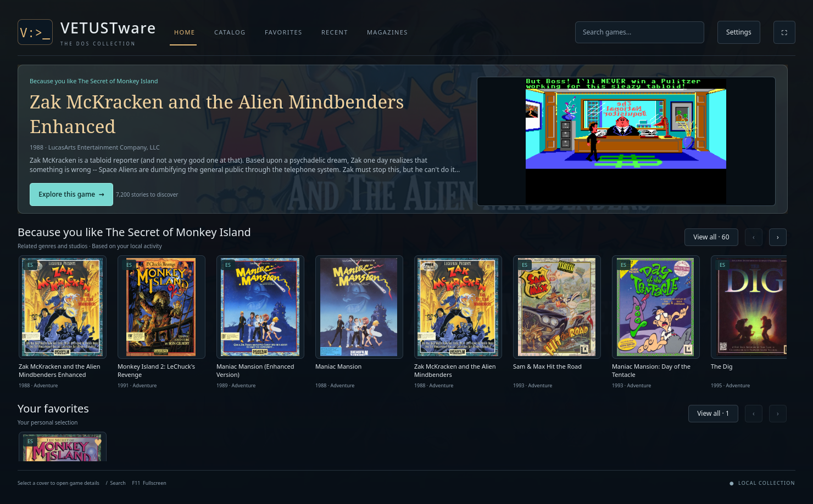
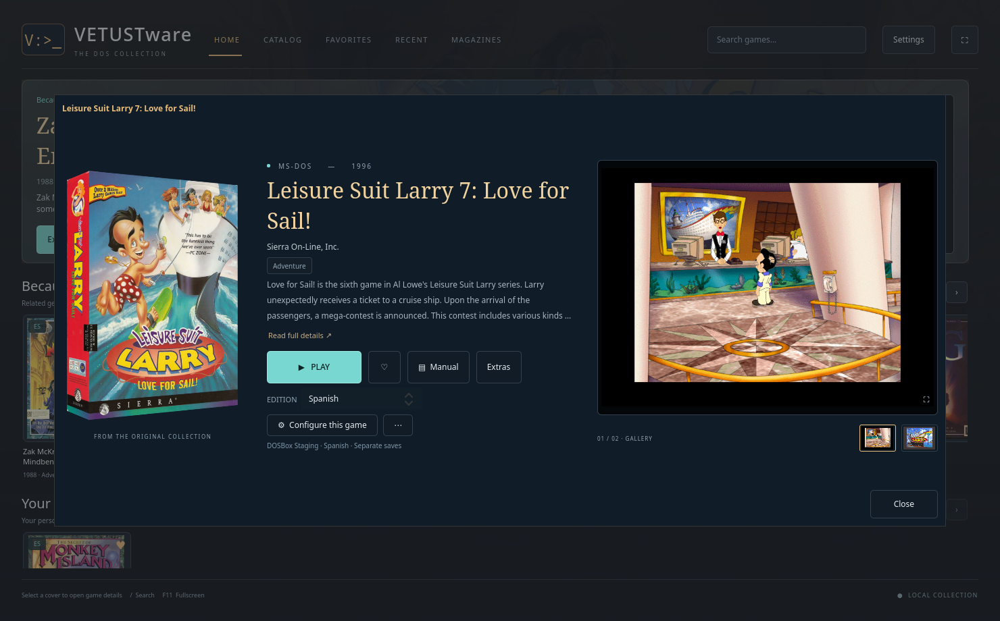
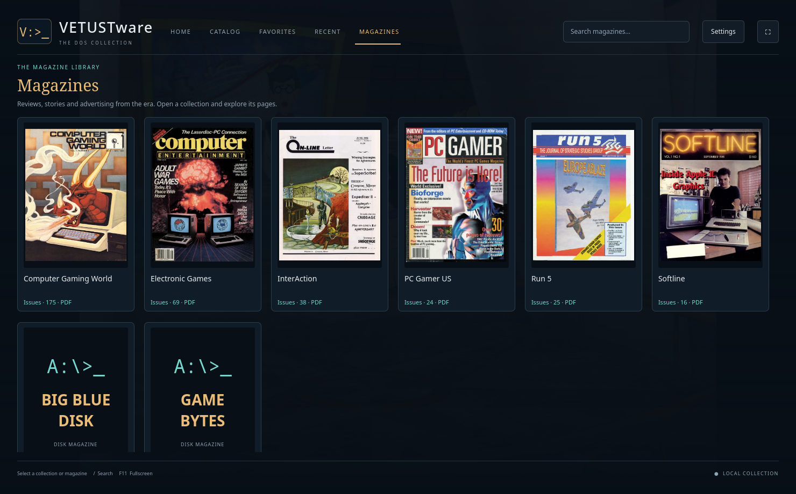
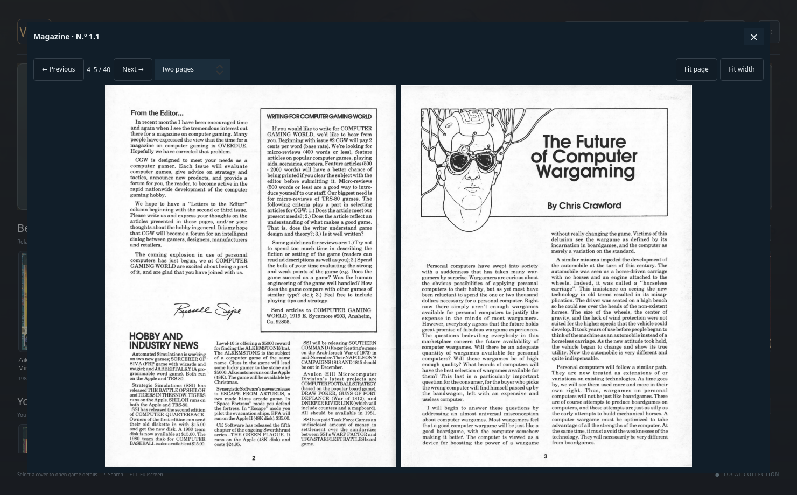
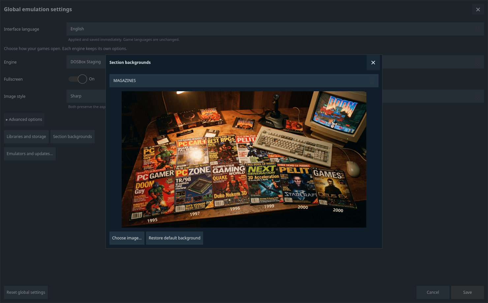
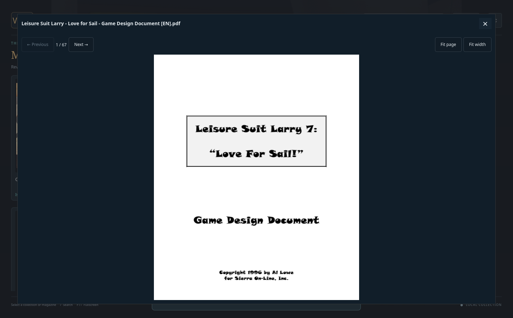

# VETUSTware

**English** · [Español](README.es.md)

**Your DOS collection, ready to explore and play.**

VETUSTware is a native Linux application built with C++20 and Qt Quick. It
organizes a local MS-DOS game library and launches games through DOSBox.
Browse covers, game details, manuals and individual emulation settings in an
interface designed for exploring your collection. No browser or account needed.



[Download 0.3.4](https://github.com/dejotaerre/vetustware/releases/tag/v0.3.4)
· [Installation guide](INSTALLATION.md)
· [Library format (Spanish)](docs/BIBLIOTECAS.md)
· [Report an issue](https://github.com/dejotaerre/vetustware/issues)

**New in 0.3.4:** optional two-page PDF spreads, with the cover alone, and
Left/Right arrow-key navigation. English is the default interface language;
Spanish is available in **Settings → Interface language**.

## What you can do

- Browse categories and selections, search for games, save favorites and return to recently played titles.
- View covers, screenshots and manuals from each game's details page.
- Choose DOSBox Staging, classic DOSBox or DOSBox-X, with global and per-game settings.
- Toggle fullscreen and select a monitor when more than one is available.
- Choose Sharp (the default) or Classic monitor (CRT) rendering in DOSBox Staging,
  globally or per game, while preserving the aspect ratio.
- Access advanced CPU, memory, video, sound and emulator executable options.
- Open a DOS console with the game's drives and disk images already mounted.
- Use XTree Gold or Norton Commander when those tools are supplied by the library.
- Recognize custom editions and profiles supplied by a VETUSTware library.
- Switch between English and Spanish without changing the language of your games.

Since 0.3.1, the **Extras** button opens supplementary documents and media
provided by the library. PDFs open inside the application; other formats use
your system's viewer. See the [extras format (Spanish)](docs/BIBLIOTECAS.md#complementos-opcionales-desde-031).

Since 0.3.2, **Magazines** offers collections with cover art, integrated PDF
reading and DOS disk magazines. This material is supplied in the library's
`Revistas/` folder; it is not included with the application. See the
[magazine format (Spanish)](docs/BIBLIOTECAS.md#revistas-opcionales).

**Game details:** edition selection, manuals, extras and individual settings.
The example shows a Spanish game edition selected within the English interface.



**Magazines:** collections of PDF publications and DOS disk magazines.



**Two-page PDF reader (0.3.4):** the cover appears alone, followed by pages 2–3,
4–5, and so on. Use Left/Right arrows to navigate, and Fit page or Fit width to
size the whole spread. This example shows Computer Gaming World with English controls.



<details>
<summary>View settings and the PDF reader</summary>

**Settings:** an interface language selector, a fullscreen switch, Sharp
rendering by default and collapsible advanced options. The monitor selector
appears only when more than one display is detected; none is shown in this capture.



**Single-page reading:** the original view remains available. This earlier capture
opens Larry 7's English game design document from Extras. Close with X or Escape.



</details>

These screenshots show a locally supplied library. The games, artwork, manuals
and magazines shown are not included with the application or its downloads.

## Get started

Version **0.3.4 is a preview release for Linux x86_64**. The published executable
was built and tested on **CachyOS with Qt 6.12**. It is not a universal package:
you need compatible system libraries. Source builds are available for other
distributions, but compatibility still needs testing.

1. Install the dependencies listed in [INSTALLATION.md](INSTALLATION.md)
   and a DOSBox emulator. Most profile work has used DOSBox Staging.
2. Download and extract `vetustware-0.3.4-linux-x86_64.tar.gz` from
   [Releases](https://github.com/dejotaerre/vetustware/releases).
3. Inside the extracted folder, run:

   ```sh
   python3 helpers/install.py --desktop
   ```

4. Open VETUSTware and select your compatible local library.

The default installation directory is `~/vetustware`. The library can live on
another drive. Playable copies are created as needed in the installation's
`data/games` folder, or in another folder chosen by the user.

The application **does not include or download games, ISOs, ROMs, cover art,
manuals, emulators or third-party DOS tools**. It can use a prepared custom
library, supplied separately.

## Application, library and saves

| Part | Contents | Location |
|---|---|---|
| Application | Executable, helpers, settings and local data | `~/vetustware` by default |
| Library | Original archives, metadata and optional custom editions | Any available folder or drive |
| Playable copies | Extracted game files and each user's saves | `data/games` or a custom location |

The library is read-only during use. Saves and player changes are stored in
playable copies. Restoring a copy from the library does not recover newer saves
that have been deleted.

VETUSTware supports the eXoDOS structure described in the documentation and
custom VETUSTware libraries. It is not a general-purpose importer for arbitrary
game folders or ISOs. See the [library format (Spanish)](docs/BIBLIOTECAS.md).

## Interface languages

VETUSTware defaults to **English**. Select **Settings → Interface
language → Español** to switch to Spanish. Changes apply immediately and are
saved for future sessions. Game editions, emulation settings and saves are
independent of the interface language.

Anyone can contribute another language through a JSON file, without changing
C++ or recompiling the application. See [Translating VETUSTware](docs/TRANSLATING.md)
for the format, validation and preview instructions. Missing translations fall
back to English.

Game descriptions, manuals, magazine content and other imported material retain
their original languages. The language selector is included from version 0.3.3.

## Build and test

Requirements: C++20, CMake 3.21 or newer, pkg-config, Qt 6.5 or newer
(Quick, QuickControls2, Sql/SQLite, Concurrent, PdfQuick and Test), libzip and SDL2.
Python 3 is used for installation, metadata import and translation validation.

```sh
cmake -S native -B native/build -DCMAKE_BUILD_TYPE=Release
cmake --build native/build -j 4
ctest --test-dir native/build --output-on-failure
python3 helpers/install.py --desktop
```

Tests use synthetic data and do not require a game collection. They cover ZIP
extraction, the catalog, emulation settings, extras, magazines, interface
navigation, translations and language persistence.

## Status and limitations

- Version 0.3.3 includes English and Spanish interfaces; imported names and descriptions depend on the library.
- Each game may require a particular DOSBox engine or specific settings. Importing a profile does not verify its compatibility.
- Linux desktops with X11 or XWayland are supported; other platforms and native Wayland have not been validated for this version.
- Monitor selection depends on the emulator and the desktop environment.
- Libraries, translations and images are not downloaded automatically.

For contributions and bug reports, see [CONTRIBUTING.md](CONTRIBUTING.md).
For interface translations, start with the [English translation guide](docs/TRANSLATING.md).

## License

VETUSTware's own code is released under the [MIT license](LICENSE).
Dependencies and third-party content retain their own licenses. Game imagery
visible in the screenshots is not covered by the code's MIT license.
See [THIRD_PARTY.md](THIRD_PARTY.md) for details.

## Contributors

- **Dejotaerre** — project creator and maintainer.
- **OpenAI Codex** — AI assistance with implementation, testing and documentation, under the maintainer's direction.
