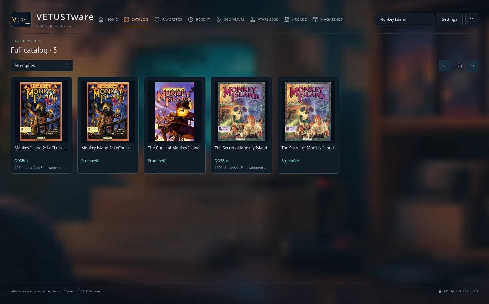
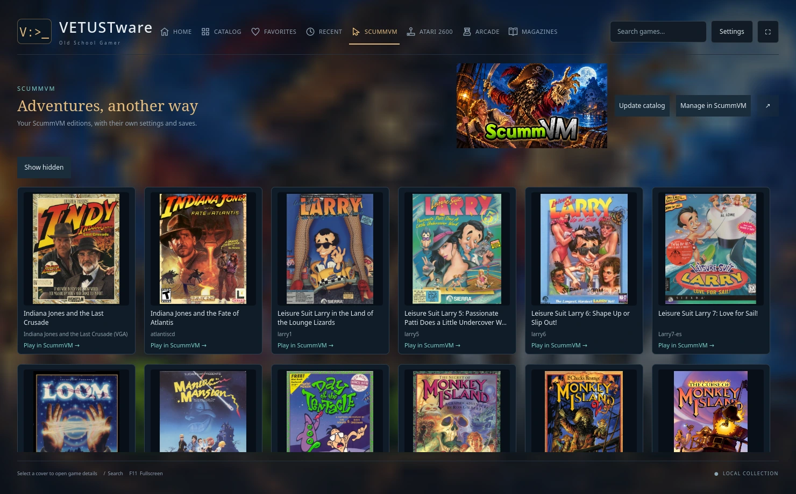
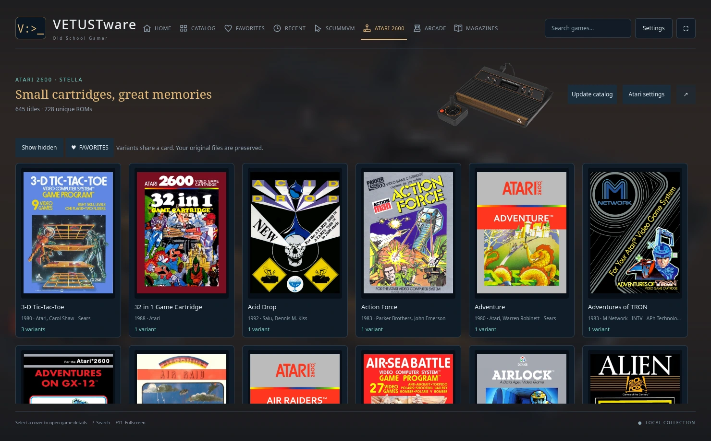
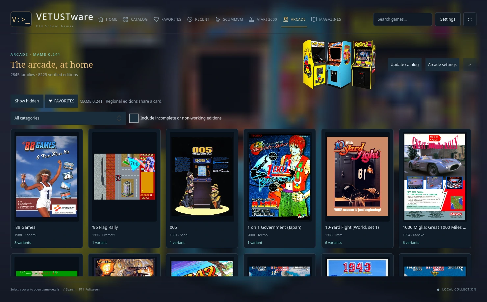

# VETUSTware · Old School Gamer

**English** · [Español](README.es.md)

VETUSTware is a native Linux frontend for a local collection of **DOS, ScummVM, Atari 2600 and arcade games**. Search across systems, pick an edition and launch it from its game details. Open a magazine to read a contemporary review, or bring up a game’s manual from its details page.


**Which version should I install?** The screenshots on this page show the current `main` branch. Build from source for the four-engine catalog. The latest downloadable preview, **0.3.4 for Linux x86_64**, offers the DOS library, magazines and PDF reader with English and Spanish controls. [Download 0.3.4](https://github.com/dejotaerre/vetustware/releases/tag/v0.3.4) · [Install the preview](https://github.com/dejotaerre/vetustware/blob/v0.3.4/INSTALLATION.md) · [Build from source](#build-from-source)

## One search, four libraries

Search for **Monkey Island** in Catalog and you can see the DOSBox and ScummVM editions side by side. Each card identifies its engine. Select an engine to narrow the results, or open its dedicated section to browse its editions and settings. Home features a rotating DOS recommendation drawn from your interests and the wider collection.



| Library | What you can do |
| --- | --- |
| **DOS · DOSBox** | Choose a supplied edition or translation, open its manual and extras, or launch a DOS prompt with the game's drives and CD image mounted. Choose Staging, classic DOSBox or DOSBox-X and override sound, display or CPU settings for one game. |
| **ScummVM** | Browse adventures in series order, select a detected edition, hide games or open the ScummVM manager. Each edition has its own launch settings and saves. |
| **Atari 2600 · Stella** | Browse by box art, inspect gameplay snapshots and choose a cartridge variant. Favorites and hidden titles help organize larger collections. |
| **Arcade · MAME 0.241** | Browse machines by family, choose a regional variant and filter by category or working status. The launcher checks the selected ROM set against MAME 0.241 before play. |

<details>
<summary>See game details and the three dedicated engine views</summary>

**DOS.** Larry 7 has a Spanish edition selected inside the English interface. Its box, screenshots, manual and extras belong to the local collection.


**ScummVM**



**Atari 2600**



**Arcade**



</details>

## Magazines and manuals

Browse magazines by series and issue. Open a PDF directly in the reader, or launch a DOS disk magazine through DOSBox. Portrait documents open in two-page mode with the cover on its own. Use the left and right arrows to turn pages, fit the spread to the window or switch to a single page.


<details>
<summary>See the magazine shelf, single-page reader and background settings</summary>


Choose a background for each section in **Settings → Section backgrounds**. The preview shows the full image. The section displays it blurred behind the collection.


</details>

## Bring your collection

VETUSTware installs in `~/vetustware` by default. In **Settings → Libraries and storage**, select the collections you own. They can live on different disks. Each organized collection carries its covers, catalogs and manuals in its own `metadata/` folder. Personal settings and saves stay with the installation by default. DOS playable copies can also use a folder you choose. Games, ROMs, disc images and publications shown here come from a local library and are supplied separately. [Library layout](docs/LIBRARIES.md)

For ScummVM and Stella, the development build prefers private runtimes in `~/vetustware/runtime` and can check manually for compatible updates. Arcade pairs a MAME 0.241 runtime with a matching ROM set. [Runtime setup and updates](docs/RUNTIMES.md) · [Arcade library and saves](docs/ARCADE.md)

## Build from source

From a checkout of `main`, install a C++20 compiler, CMake 3.21+, pkg-config, Qt 6.5+ (Quick, Quick Controls, QML Dialogs, Quick Effects, SQL with SQLite, Concurrent, PDF Quick and Test), libzip, SDL2 and Python 3. Run the following commands from the repository root.

```sh
cmake -S native -B native/build -DCMAKE_BUILD_TYPE=Release
cmake --build native/build -j 4
ctest --test-dir native/build --output-on-failure
python3 helpers/install.py --desktop
```

Open VETUSTware from the application menu and select your libraries. The 0.3.4 binary preview was built on CachyOS with Qt 6.12 and requires compatible system libraries. Use the library format documented for that release when installing its package. [0.3.4 installation guide](https://github.com/dejotaerre/vetustware/blob/v0.3.4/INSTALLATION.md)

## Languages and contributions

The current interface opens in **English** and also supports **Español** and **Português (Brasil)**. Change it in **Settings → Interface language**. Games and publications keep their own languages. To contribute another translation, add a JSON dictionary and run the validator. [Translation guide](docs/TRANSLATING.md) · [Contributing](CONTRIBUTING.md) · [Report an issue](https://github.com/dejotaerre/vetustware/issues)

Dejotaerre created and maintains VETUSTware, with assistance from OpenAI Codex in implementation, testing and documentation. The project's own code uses the MIT license. Dependencies, game artwork and publications retain their respective licenses. [License](LICENSE) · [Third-party notices](THIRD_PARTY.md)
